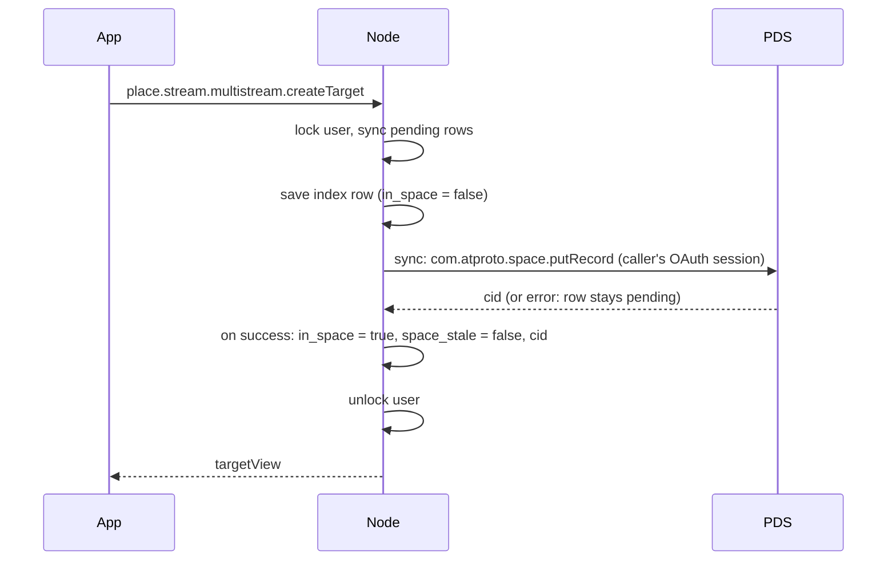

# atproto spaces

Streamplace copies each user's private records into an
[atproto space](https://github.com/bluesky-social/proposals/tree/main/0016-permissioned-data)
on the user's own PDS: data that must never reach the firehose, such as a
multistream target's RTMP URL with its stream key. The node keeps these records
in its stateful database and syncs them when the caller has a space grant.

Spaces are an alpha that ships breaking changes weekly. This document
describes the wire Streamplace targets, pinned in [Testing](#testing).

## The personal space

Every user has at most one Streamplace space, with the user's own DID as its
authority:

```
at://{did}/space/place.stream.personal/self
```

| Part       | Value                              | Notes                                               |
| ---------- | ---------------------------------- | --------------------------------------------------- |
| space type | `place.stream.personal`            | one type for all private Streamplace data           |
| space key  | `self`                             | one space per user                                  |
| policy     | `com.atproto.personalspace.policy` | only the owner can read; there are no other writers |

A record in it is addressed as
`at://{did}/space/place.stream.personal/self/{did}/{collection}/{rkey}`.
`pkg/spaces` builds the personal space URI and holds the few
`com.atproto.space.*` calls the node makes (`createSpace`, `putRecord`,
`deleteRecord`).

Collections in the space today:

| Collection                        | Node index                          |
| --------------------------------- | ----------------------------------- |
| `place.stream.multistream.target` | statedb table `multistream_targets` |

The other private data in statedb moves the same way, one collection at a
time; see [Adding a collection](#adding-a-collection).

## Authorization

A PDS only lets the node touch a space through an OAuth grant; vlpds refuses
password and app-password sessions outright. The grant is a permission
inside the `place.stream.authFull` permission set the app already requests:

```json
{
  "type": "permission",
  "resource": "space",
  "spaceType": "place.stream.personal",
  "authority": "self",
  "collection": ["place.stream.multistream.target"],
  "action": ["read", "create", "update", "delete"],
  "manage": ["create"]
}
```

It lives in the permission set, not in the scope string, on purpose:

- The scope string (`include:place.stream.authFull`) does not change, so
  nobody has to log in again. A PDS re-expands the permission set when it
  refreshes a token, and the node stores the granted scope from every
  refresh, so existing sessions pick the grant up on their own.
- A PDS without spaces ignores a permission whose resource it does not know
  and logs the user in as before. An explicit `space:` scope would instead be
  dropped at login for good, and need a fresh login once that PDS gains
  spaces.

A PDS with spaces also resolves the space type declaration,
`place.stream.personal`, to show its `name` on the consent screen. Login
fails with `invalid_scope` if it cannot, so the declaration is published
with the permission set.

### Where the two lexicon documents live

The declaration (`"type": "space"`) and the permission (`"resource":
"space"`) are not valid to indigo's lexicon parser, which glex and the
node's own lexicon loading run over every file under `lexicons/`. Both
documents therefore live in `pkg/spaces/lexicons/` as raw JSON:

- `place.stream.personal.json`, written by hand.
- `place.stream.authFull.json`, generated by `make lexicons`: the ordinary
  `lexicons/place/stream/authFull.json` plus the space permission, whose
  collections are copied from the declaration.

Whoever publishes lexicons to the `place.stream` authority account (the
release script, and the e2e harness for its local authority) publishes these
in place of the same-named documents from `lexicons/`. When indigo and glex
can parse spaces, move both files into `lexicons/` and delete the overlay.

## How the node uses the space

The statedb index supplies the records the node serves and copies to the
space. A live stream's multistream loop reads its targets every few seconds
with no user request in flight, and every node of a station has to see the
same answer. The space holds the last successfully synced copy.



- **Create and update** write the index first. Update also sets
  `space_stale = true`. Neither operation fails because the PDS is unavailable.
- **Sync** uses one function, `SyncMultistreamTargets`, to copy pending rows
  to the space, then mark them synced and store the returned CID.
- **Delete** removes the PDS record first when `in_space = true`. It requires
  a usable client and leaves the index untouched on a PDS error. A retry is
  safe even if the PDS delete succeeds and the SQL delete fails.
- **Reads** come from the index.
- **Row URIs never change.** The index and every API view use
  `at://{did}/place.stream.multistream.target/{rkey}`. `in_space` means a copy
  exists in the space under the same collection and key; `space_stale` means
  the row changes are pending sync.

### Moving a user over

Every multistream call takes a per-user lock before choosing a space client,
including calls without OAuth. Lock failures fail the request rather than
allowing unlocked edits. The helper uses the caller's own OAuth session, not
another login's stored session. No session, a failed refresh, or no granted
`space:place.stream.personal` scope means no client.

With a client, the helper runs `SyncMultistreamTargets` under that lock. It
copies every row with `in_space = false` or `space_stale = true`, then sets
`in_space = true`, `space_stale = false` and the returned CID. URI and event
references stay untouched. Both columns default to false, so existing rows
are picked up. The first error stops sync without clearing that row's pending
flags; a failed SQL acknowledgment also leaves it eligible for retry.

Create and update sync again after their index write, still under the lock.
Sync errors are logged, not returned: saved changes stay available to the
director and pending rows are retried on the user's next multistream call.
A PDS without spaces or an unavailable client leaves creates and updates
local. Deleting a row with `in_space = true` needs the PDS; a row with
`in_space = false` is deleted locally.

## Adding a collection

1. Make sure the data is an atproto record with a lexicon under `lexicons/`.
2. Add the collection to `collections` in
   `pkg/spaces/lexicons/place.stream.personal.json` and run `make lexicons`.
   Existing sessions gain write access to it on their next token refresh.
3. Save in statedb first and copy pending rows through one sync function using
   `pkg/spaces`, as the multistream handlers do. Hold the per-user lock from
   client selection through index writes and sync. Keep row URIs stable and
   track space backing and pending changes separately, with defaults that
   include existing rows. Space-backed deletes require the PDS.
4. Extend the e2e flows below.

Candidates, in rough order of readiness:

| Data                   | Today                                     | Needs                                                          |
| ---------------------- | ----------------------------------------- | -------------------------------------------------------------- |
| Draft videos           | `draft_videos`, already shaped as records | its `ats://` URIs and separate space type folded into this one |
| S3 storage credentials | `storage`, a plain SQL row                | a record lexicon; nothing reads the stored URL yet             |
| Webhooks               | `webhooks`, plain SQL columns             | a record lexicon                                               |

## Testing

`DEV_ENV_PDS` selects the PDS the e2e harness starts:

| `DEV_ENV_PDS` | PDS                                                             | Covers                                 |
| ------------- | --------------------------------------------------------------- | -------------------------------------- |
| unset         | reference PDS, stable release                                   | a PDS without spaces: the old path     |
| `spaces`      | reference PDS, `@atproto/pds@0.0.0-spaces-alpha-20261105160032` | the alpha as Bluesky ships it          |
| `vlpds`       | [vlpds](https://github.com/jazware/vlpds), image `sha-dba483f`  | the PDS Streamplace runs in production |

```sh
hack/fetch-spaces-pds.sh   # once: installs the alpha PDS beside the workspace
hack/fetch-vlpds.sh        # once, on a machine with Docker
hack/e2e-web-local.sh flows/private-space.spec.ts
DEV_ENV_PDS=spaces hack/e2e-web-local.sh flows/private-space.spec.ts
DEV_ENV_PDS=vlpds hack/e2e-web-local.sh flows/private-space.spec.ts
```

In HTTPS mode the harness seeds one multistream target for the test account
before anything logs in, so it lands on the old path. The flows then log in through
the PDS's real consent screen and check, by reading the space from the PDS
with its admin credentials, that the seeded target moved into the space and
that creating, renaming and deleting a target in the app does the same on
the PDS. `js/e2e-web/flows/private-space.spec.ts` covers the web app and
`.maestro/logged-in/private-space.yaml` the mobile apps.

Both spaces PDSes must agree on the wire. vlpds releases up to 1.3.0, and
the `bluesky-social/vlpds` fork, implement an older, incompatible alpha
(`simplespace`); only vlpds builds from 7 November 2026 on speak this one.
To move to a newer alpha, change the version in
`js/dev-env/spaces-pds/package.json`, the image in `hack/fetch-vlpds.sh`,
and the table above together.

Neither spaces PDS is installed by the root workspace. The alpha PDS lives in
`js/dev-env/spaces-pds/`, a workspace of its own with its own lockfile, so
its prerelease dependency tree cannot disturb the app's.

The local PLC serves modern `Multikey` DID documents for every flavor, keeping
the same public keys and signed operation logs. Its legacy library otherwise
serves raw 2019 ECDSA keys, which the pinned vlpds cannot use to verify the
lexicon publisher's CAR proofs.

## Limits

- The node does not read the space back. A record another app writes into
  the space does not reach the index.
- The index still holds a copy of every private record, in statedb.
- API record URIs identify index rows, not the records' space addresses.
- Space copies can lag the index while the PDS or client is unavailable.
  Pending rows retry on the user's next multistream call; no background sync runs.
- The Maestro flow runs on Android. Nothing in the repository runs
  backend-backed flows on iOS yet.
