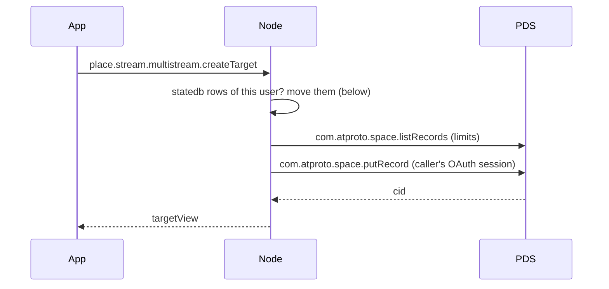
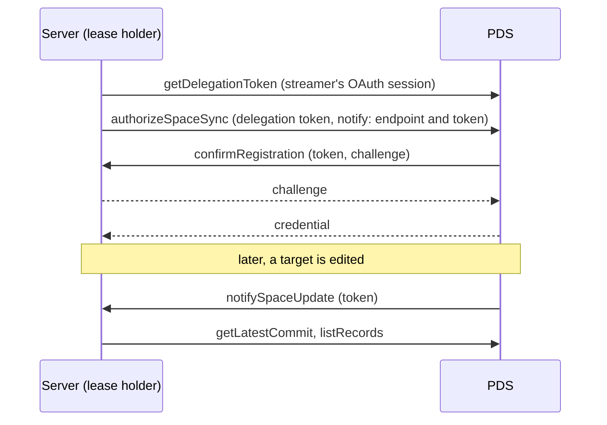

# atproto spaces

Streamplace stores granted users' private records in an
[atproto space](https://github.com/bluesky-social/proposals/tree/main/0016-permissioned-data)
on their own PDS. They do not reach the public repo or firehose. The space
holds user-editable data; operational state stays under the station's control.

Spaces are an alpha that ships breaking changes weekly. This document
describes the wire Streamplace targets, pinned in [Testing](#testing).

## The personal space

Every user has at most one Streamplace space, with the user's own DID as its
authority:

```
at:space/{did}/place.stream.personal/self
```

| Part       | Value                              | Notes                                               |
| ---------- | ---------------------------------- | --------------------------------------------------- |
| space type | `place.stream.personal`            | one type for all private Streamplace data           |
| space key  | `self`                             | one space per user                                  |
| policy     | `com.atproto.personalspace.policy` | only the owner can read; there are no other writers |

A record in it is addressed as
`at:space/{did}/place.stream.personal/self/{did}/{collection}/{rkey}`.
`pkg/spaces` builds the personal space URI and holds the few
`com.atproto.space.*` calls the node makes.

Collections in the space today:

| Collection                        | What moves from statedb                  |
| --------------------------------- | ---------------------------------------- |
| `place.stream.multistream.target` | RTMP targets from `multistream_targets`  |
| `place.stream.vod.draftMetadata`  | Editable fields from `draft_videos.data` |

The other private data in statedb moves the same way, one collection at a
time; see [Adding a collection](#adding-a-collection).

## Authorization

A PDS only lets the node touch a space through an OAuth grant; vlpds refuses
password and app-password sessions outright. The grant is a permission
inside the `place.stream.authFull` permission set the app already requests:

```json
{
  "type": "permission",
  "resource": "space",
  "spaceType": "place.stream.personal",
  "authority": "self",
  "collection": [
    "place.stream.multistream.target",
    "place.stream.vod.draftMetadata"
  ],
  "action": ["read", "create", "update", "delete"],
  "manage": ["create"]
}
```

It lives in the permission set, not in the scope string, on purpose:

- The scope string (`include:place.stream.authFull`) does not change, so
  nobody has to log in again. A PDS re-expands the permission set when it
  refreshes a token, and the node stores the granted scope from every
  refresh, so existing sessions pick the grant up on their own.
- A PDS without spaces ignores a permission whose resource it does not know
  and logs the user in as before. An explicit `space:` scope would instead be
  dropped at login for good, and need a fresh login once that PDS gains
  spaces.

A PDS with spaces also resolves the space type declaration,
`place.stream.personal`, to show its `title` on the consent screen. Login
fails with `invalid_scope` if it cannot, so the declaration is published
with the permission set.

### Where the two lexicon documents live

The declaration (`"type": "space"`) and the permission (`"resource":
"space"`) are not valid to indigo's lexicon parser, which the node's own
lexicon loading runs over every file under `lexicons/`, nor is the
declaration valid to the JS `lex build`. Both documents therefore live in
`pkg/spaces/lexicons/` as raw JSON:

- `place.stream.personal.json`, written by hand.
- `place.stream.authFull.json`, generated by `make lexicons`: the ordinary
  `lexicons/place/stream/authFull.json` plus the space permission, whose
  collections are copied from the declaration.
- `lexicons/place/stream/vod/draftMetadata.json` is a normal record schema
  used for codegen and validation. The generator excludes it from the
  public `repo` permission in both variants of `authFull`.

Whoever publishes lexicons to the `place.stream` authority account (the
release script, and the e2e harness for its local authority) publishes these
in place of the same-named documents from `lexicons/`. Once the node loads
lexicons with glex's `lexicon` package, and glex and the JS tooling accept
this alpha's space declarations (glex still wants the `name` that became
`title`), move both files into `lexicons/` and delete the overlay.

## Multistream targets

On a standalone node, the caller's grant selects the store:

| The caller's session               | Store                             |
| ---------------------------------- | --------------------------------- |
| has the `space:` grant             | the personal space, on the PDS    |
| has none (PDS without spaces, etc) | statedb, exactly as before spaces |

In an [object-backed station](../js/docs/src/content/docs/guides/installing/downloading-streamplace.md#object-backed-station-linux-prototype),
legacy SQL targets move into an encrypted document on the creator's SlateDB
shard. A full space grant moves those targets to the PDS at the same rkeys.
Once that move starts, a grantless session cannot recreate a second copy on
the shard. A director on another node requests active targets from the owner;
it does not open a second writer or recover secrets from stale SQL rows.



- **Every multistream call** of a granted caller goes to the PDS with the
  caller's own OAuth session. A PDS error fails the call; nothing falls back
  to statedb, which would make a second store.
- **Lists** read the space and add each target's latest status event, which
  stays in statedb (`multistream_events`): it is the node's own operational
  state, not the user's data.
- **URIs never change.** Every API view uses
  `at://{did}/place.stream.multistream.target/{rkey}` whichever store holds
  the record, and the space record keeps the rkey. Events and running pushes
  are keyed by that URI, so moving a user disturbs neither.
- **Limits** (100 targets, 5 active) are checked against the space before a
  write, to tell the user at once. That check cannot be a guarantee: it is not
  atomic with the write, and another app can write to the space. What holds
  is that the director drives at most the first 5 active targets it reads.

### The server driving a stream

The server that holds a stream's multistream lease reads the streamer's
targets with no user request in flight (`HandleMultistreamTargets`). It looks
for a stored session of the streamer that has the grant:

- **Found**: it moves any statedb rows, reads the targets from the space into
  memory, then asks the PDS only for the space repo's revision
  (`com.atproto.space.getLatestCommit`) and reads the targets again when
  that changes. It reuses its client until the access token is about to run
  out, so statedb is not asked again in between.
- **Not found**, or the space could not be opened: it reads statedb as
  before, and looks again every minute. It looks at once when statedb has no
  active targets, which is also what statedb shows just after they moved, so
  a move under a running stream restarts no push.

When the PDS cannot be read, the server keeps driving the targets it last
saw. A server that starts driving a moved user's stream while the PDS is
down has none until it comes back.

### Change notifications

A server driving a stream has the PDS tell it when the space changes, so an
edit takes effect at once and the server need not poll every few seconds:



- **Each server registers itself**, with `https://{server host}` as the
  endpoint, so a notification reaches the lease holder with no forwarding
  between nodes; a new lease holder registers on taking over.
- **Registration** (`spaces.Follow`) happens before the first read, so no
  change falls between the two. It lasts only as long as the credential the
  PDS answers with, 10 minutes on both PDSes, so the server asks again at
  half that for as long as it drives the stream. It never uses the
  credential: it reads the space with the streamer's OAuth session.
- **The token** is what a notification is trusted by; there is no service
  auth. It is an HMAC of the space URI under a key the process makes at
  startup (`spaces.NotifyToken`), so nothing is stored, and a restart
  registers afresh under a new token.
- **A notification** carries no records. `notifySpaceUpdate`
  (`pkg/spxrpc/com_atproto_space.go`) checks the token, then wakes the
  stream's loop over the in-process bus, which reads the space again,
  whatever kind of update it was. `confirmRegistration` checks the same
  token and echoes the PDS's challenge.
- **Nothing unregisters explicitly.** When a stream ends the server stops
  asking, the registration lapses, and the PDS's `registrationExpired`
  notice is refused, which is how the protocol has a syncer unregister. A
  stream that is still running registers again on its next turn.
- **Polling stays as the fallback**: every minute while registered, every 5
  seconds while not. Delivery of writes is best effort, and a PDS that
  cannot register the server is asked again every minute.
- `streamplace_space_notifications_total` counts the notifications accepted.

A server the PDS cannot reach at `https://{server host}` (behind NAT, or
serving plain HTTP on a development port) fails the confirmation, registers
nothing, and relies on the 5-second poll.

### Moving a user over

`MoveMultistreamTargets` runs at the start of every multistream call by a
granted caller, and when a server driving a stream finds a granted session.
It costs one statedb query when there is nothing to move. Otherwise, under a
per-user lock, it writes each row to the space at the same rkey, then
deletes all of them in one statement:

- A failed write deletes nothing, and the next call starts over.
- The rows leave together and only once the space has every record, so a
  server driving the stream sees all of the targets in one store or the
  other and restarts no push.
- A row is deleted only if it still has the content that was copied. One
  edited meanwhile, by a session without the grant, stays for the next move.

On a standalone node a session without the grant sees statedb only, so for a
user who has moved it lists nothing and can create a row there. That row moves
on the user's next granted call or stream. Station mode instead refuses that
write after cutover.

## Private VOD drafts

The `place.stream.vod.*Draft` endpoints still return the same `ats://` URIs
and `draftVideo` views. The node joins private metadata at the same rkey with
its operational row. Title, description and facets, thumbnail, tags,
activity, content warnings and content rights live on the PDS. Connections,
creation time, processing status, source, duration, errors and upload/content
IDs come only from the node.

- **The move is sticky per DID and collection.** A session without the
  expanded draft grant uses statedb only if the account has never started the
  move. After that it must reauthorize, even if it has no remaining drafts.
  A multistream-only grant does not count. The node uses the request's own
  OAuth session; refresh and PDS errors do not fall back to statedb.
  A directly delegated action-specific grant can operate on previously
  materialized records only after migration completes. It cannot migrate
  SQL records or initialize pending worker drafts.
- **Migration is create-only.** A record already at the rkey wins. Each
  successful create clears that row's editable SQL fields before the move
  continues. If a response is lost, the node checks the current record and
  the space's operation history before retrying. An atomic create/delete at a
  separate key supplies a revision even in an initially empty repo. If the
  history cannot be verified, migration fails closed rather than risking resurrection.
- **Workers write processing state locally.** An implicit upload draft is
  anchored before processing starts. After cutover the worker leaves an
  operational-only pending anchor. The next full-grant access initializes
  it from the upload filename, publication task, or public livestream defaults.
  A failed publication's metadata is removed from its terminal job in the
  same transaction that marks the private draft materialized. A previously
  materialized record removed directly on the PDS is not pending.
- **Edits and publishes are serialized on the node.** Updates use
  `applyWrites#update` so a direct PDS delete between read and write cannot
  recreate the record. The pinned alpha has no record CAS, so an edit from
  another app can still race with a Streamplace edit.
- **Publish and cleanup are separate writes.** After the public record is
  written and its media advertised, the node checkpoints the public result
  before deleting the private record and local anchor. If cleanup fails, a
  publish retry resumes cleanup without rewriting the public record. An
  already absent private record does not block deletion of the owned anchor.
  Once checkpointed, Streamplace rejects metadata edits and replacement
  uploads with HTTP 409. Edit the public video, not its published draft.
  Private draft creation from a finalized livestream requires the owner's
  grant after cutover, not a moderator's session.

## Adding a collection

1. Make sure the data is an atproto record with a lexicon under `lexicons/`.
2. Add the collection to `collections` in
   `pkg/spaces/lexicons/place.stream.personal.json` and run `make lexicons`.
   Existing sessions gain access to it on their next token refresh.
3. Use the caller's expanded grant with `pkg/spaces`. Define the fallback
   and cutover rules for the collection, and keep API URIs stable.
4. Extend the e2e flows below.

Candidates, in rough order of readiness:

| Data                   | Today                         | Needs                                              |
| ---------------------- | ----------------------------- | -------------------------------------------------- |
| S3 storage credentials | `storage`, a plain SQL row    | a record lexicon; nothing reads the stored URL yet |
| Webhooks               | `webhooks`, plain SQL columns | a record lexicon                                   |

## Testing

`DEV_ENV_PDS` selects the PDS the e2e harness starts:

| `DEV_ENV_PDS` | PDS                                                             | Covers                                 |
| ------------- | --------------------------------------------------------------- | -------------------------------------- |
| unset         | reference PDS, stable release                                   | a PDS without spaces: the old path     |
| `spaces`      | reference PDS, `@atproto/pds@0.0.0-spaces-alpha-20261124235736` | the alpha as Bluesky ships it          |
| `vlpds`       | [vlpds](https://github.com/jazware/vlpds), image `sha-0f57955`  | the PDS Streamplace runs in production |

```sh
hack/fetch-spaces-pds.sh   # once: installs the alpha PDS beside the workspace
hack/fetch-vlpds.sh        # once, on a machine with Docker
hack/e2e-web-local.sh flows/private-space.spec.ts
DEV_ENV_PDS=spaces hack/e2e-web-local.sh flows/private-space.spec.ts
DEV_ENV_PDS=vlpds hack/e2e-web-local.sh flows/private-space.spec.ts
```

In HTTPS mode the harness seeds one multistream target for the test account
before anything logs in, so it lands in statedb. The flows then log in through
the PDS's real consent screen and check, by reading the space from the PDS
with its admin credentials, that the seeded target moved into the space and
that creating, renaming and deleting a target in the app does the same on
the PDS. The web flow also checks that statedb is left empty, and that the
director reports on a target once it is switched on.
`js/e2e-web/flows/private-space.spec.ts` covers the web app and
`.maestro/logged-in/private-space.yaml` the mobile apps.
The matching `private-draft` flows open a seeded legacy draft, edit and reopen
it, delete it, and check the private record directly on a Spaces-capable PDS.

Both spaces PDSes must agree on the wire, which here is the alpha of 24
November 2026 (atproto `1f510f8`), the first with `at:space/` URIs. vlpds
speaks it from release 1.5.0; the pinned image is 1.5.1. Earlier releases
and the `bluesky-social/vlpds` fork implement older alphas. To move to a
newer alpha, change the version in `js/dev-env/spaces-pds/package.json`, the
image in `hack/fetch-vlpds.sh`, and the table above together.

Neither spaces PDS is installed by the root workspace. The alpha PDS lives in
`js/dev-env/spaces-pds/`, a workspace of its own with its own lockfile, so
its prerelease dependency tree cannot disturb the app's.

The local PLC serves modern `Multikey` DID documents for every flavor, keeping
the same public keys and signed operation logs. Its legacy library otherwise
serves raw 2019 ECDSA keys, which the pinned vlpds cannot use to verify the
lexicon publisher's CAR proofs.

## Limits

- A node needs the PDS to read or change a granted user's targets. There is
  no cache on disk: see [The server driving a stream](#the-server-driving-a-stream).
- A server can only read a user's space with that user's OAuth tokens, which
  are in statedb (`oauth_sessions`), as are the status events and the leases.
- API record URIs are not the records' space addresses.
- Android CI runs the Maestro flows on the default and alpha reference PDSes.
  iOS CI runs the private-draft flow against the alpha PDS using
  `hack/e2e-local.sh ios`.
