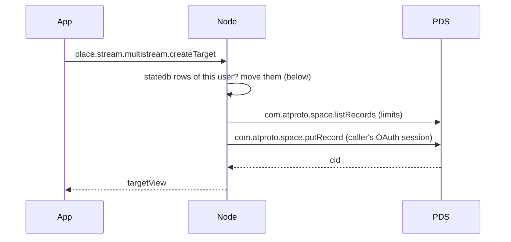
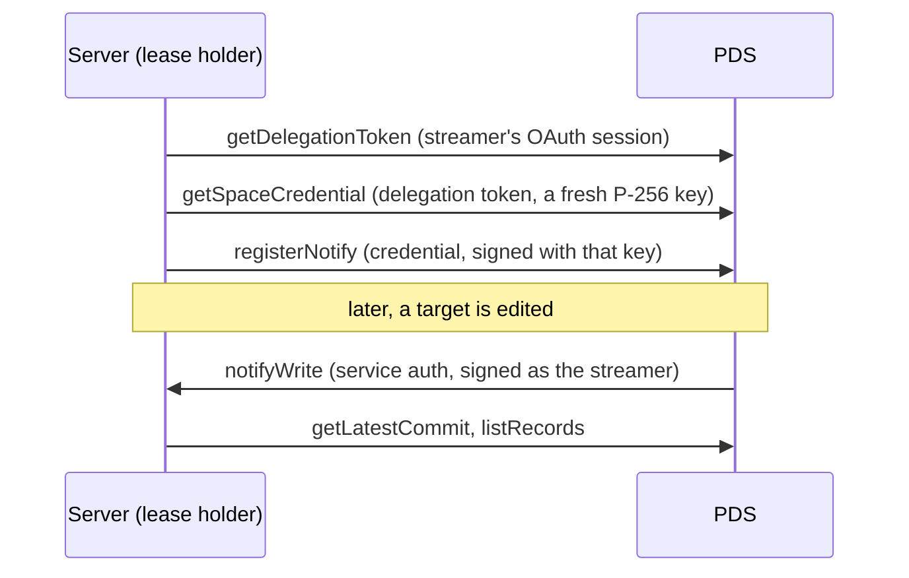

# atproto spaces

Streamplace keeps each user's private records in an
[atproto space](https://github.com/bluesky-social/proposals/tree/main/0016-permissioned-data)
on the user's own PDS: data that must never reach the firehose, such as a
multistream target's RTMP URL with its stream key. The space is the only
store for a user who has granted it; a node holds no copy beyond the memory
of a stream that is using the records.

Spaces are an alpha that ships breaking changes weekly. This document
describes the wire Streamplace targets, pinned in [Testing](#testing).

## The personal space

Every user has at most one Streamplace space, with the user's own DID as its
authority:

```
at://{did}/space/place.stream.personal/self
```

| Part       | Value                              | Notes                                               |
| ---------- | ---------------------------------- | --------------------------------------------------- |
| space type | `place.stream.personal`            | one type for all private Streamplace data           |
| space key  | `self`                             | one space per user                                  |
| policy     | `com.atproto.personalspace.policy` | only the owner can read; there are no other writers |

A record in it is addressed as
`at://{did}/space/place.stream.personal/self/{did}/{collection}/{rkey}`.
`pkg/spaces` builds the personal space URI and holds the few
`com.atproto.space.*` calls the node makes.

Collections in the space today:

| Collection                        | Before the space                    |
| --------------------------------- | ----------------------------------- |
| `place.stream.multistream.target` | statedb table `multistream_targets` |

The other private data in statedb moves the same way, one collection at a
time; see [Adding a collection](#adding-a-collection).

## Authorization

A PDS only lets the node touch a space through an OAuth grant; vlpds refuses
password and app-password sessions outright. The grant is a permission
inside the `place.stream.authFull` permission set the app already requests:

```json
{
  "type": "permission",
  "resource": "space",
  "spaceType": "place.stream.personal",
  "authority": "self",
  "collection": ["place.stream.multistream.target"],
  "action": ["read", "create", "update", "delete"],
  "manage": ["create"]
}
```

It lives in the permission set, not in the scope string, on purpose:

- The scope string (`include:place.stream.authFull`) does not change, so
  nobody has to log in again. A PDS re-expands the permission set when it
  refreshes a token, and the node stores the granted scope from every
  refresh, so existing sessions pick the grant up on their own.
- A PDS without spaces ignores a permission whose resource it does not know
  and logs the user in as before. An explicit `space:` scope would instead be
  dropped at login for good, and need a fresh login once that PDS gains
  spaces.

A PDS with spaces also resolves the space type declaration,
`place.stream.personal`, to show its `name` on the consent screen. Login
fails with `invalid_scope` if it cannot, so the declaration is published
with the permission set.

### Where the two lexicon documents live

The declaration (`"type": "space"`) and the permission (`"resource":
"space"`) are not valid to indigo's lexicon parser, which the node's own
lexicon loading runs over every file under `lexicons/`, nor is the
declaration valid to the JS `lex build`. Both documents therefore live in
`pkg/spaces/lexicons/` as raw JSON:

- `place.stream.personal.json`, written by hand.
- `place.stream.authFull.json`, generated by `make lexicons`: the ordinary
  `lexicons/place/stream/authFull.json` plus the space permission, whose
  collections are copied from the declaration.

Whoever publishes lexicons to the `place.stream` authority account (the
release script, and the e2e harness for its local authority) publishes these
in place of the same-named documents from `lexicons/`. glex already accepts
both documents. Once the node loads lexicons with glex's `lexicon` package
and the JS tooling accepts space declarations, move both files into
`lexicons/` and delete the overlay.

## How the node uses the space

A user's targets are in exactly one of two places:

| The caller's session               | Store                             |
| ---------------------------------- | --------------------------------- |
| has the `space:` grant             | the personal space, on the PDS    |
| has none (PDS without spaces, etc) | statedb, exactly as before spaces |



- **Every multistream call** of a granted caller goes to the PDS with the
  caller's own OAuth session. A PDS error fails the call; nothing falls back
  to statedb, which would make a second store.
- **Lists** read the space and add each target's latest status event, which
  stays in statedb (`multistream_events`): it is the node's own operational
  state, not the user's data.
- **URIs never change.** Every API view uses
  `at://{did}/place.stream.multistream.target/{rkey}` whichever store holds
  the record, and the space record keeps the rkey. Events and running pushes
  are keyed by that URI, so moving a user disturbs neither.
- **Limits** (100 targets, 5 active) are checked against the space before a
  write. Another app can write to the space too, so the director also drives
  at most the first 5 active targets it reads.

### The server driving a stream

The server that holds a stream's multistream lease reads the streamer's
targets with no user request in flight (`HandleMultistreamTargets`). It looks
for a stored session of the streamer that has the grant:

- **Found**: it moves any statedb rows, reads the targets from the space into
  memory, then asks the PDS only for the space repo's revision
  (`com.atproto.space.getLatestCommit`) and reads the targets again when
  that changes. It reuses its client until the access token is about to run
  out, so statedb is not asked again in between.
- **Not found**: it reads statedb as before, and looks for a session again
  whenever statedb has no active targets for the streamer.

When the PDS cannot be read, the server keeps driving the targets it last
saw. A server that starts driving a stream while the PDS is down has none
until it comes back.

### Change notifications

A server driving a stream has the PDS tell it when the space changes, so an
edit takes effect at once and the server need not poll every few seconds:



- **Each server registers itself**, as `did:web:{server host}#streamplace`,
  which its DID document already publishes. The PDS resolves that to the
  server's own address, so a notification reaches the lease holder with no
  forwarding between nodes; a new lease holder registers on taking over.
- **Registration** (`spaces.RegisterNotify`) happens before the first read,
  so no change falls between the two. It lasts 24 hours and is renewed an
  hour before it lapses. The credential and its key are used once and
  dropped.
- **A notification** carries no records. `com.atproto.space.notifyWrite`
  (`pkg/spxrpc/com_atproto_space.go`) accepts it only from the space's own
  authority, then wakes the stream's loop over the in-process bus, which
  reads the space again. `notifySpaceDeleted` is handled the same way.
- **Polling stays as the fallback**: every minute while registered, every 5
  seconds while not. Delivery is best effort (the reference PDS sends once,
  vlpds retries for about 30 seconds), and a PDS that cannot register the
  server, because the space does not exist yet or the server's DID does not
  resolve, is asked again every minute.
- `streamplace_space_notifications_total` counts the notifications accepted.

A server the PDS cannot reach over HTTPS (behind NAT, or on a non-default
port, which this `did:web` cannot express) registers nothing or receives
nothing, and relies on the poll.

### Moving a user over

`MoveMultistreamTargets` runs at the start of every multistream call by a
granted caller, and when a server driving a stream finds a granted session.
It costs one statedb query when there is nothing to move. Otherwise, under a
per-user lock, it writes each row to the space at the same rkey, then
deletes all of them in one statement:

- A failed write deletes nothing, and the next call starts over.
- The rows leave together and only once the space has every record, so a
  server driving the stream sees all of the targets in one store or the
  other and restarts no push.
- A row is deleted only if it still has the content that was copied. One
  edited meanwhile, by a session without the grant, stays for the next move.

A session without the grant sees statedb only, so for a user who has moved it
lists nothing and can create a row there. That row moves on the user's next
granted call or stream.

## Adding a collection

1. Make sure the data is an atproto record with a lexicon under `lexicons/`.
2. Add the collection to `collections` in
   `pkg/spaces/lexicons/place.stream.personal.json` and run `make lexicons`.
   Existing sessions gain access to it on their next token refresh.
3. Read and write it with `pkg/spaces` when the caller has the grant, as the
   multistream handlers do, and keep the statedb path for callers without.
   Move existing rows the way `MoveMultistreamTargets` does: write, then
   delete what was written. Keep API URIs stable across the move.
4. Extend the e2e flows below.

Candidates, in rough order of readiness:

| Data                   | Today                                     | Needs                                                          |
| ---------------------- | ----------------------------------------- | -------------------------------------------------------------- |
| Draft videos           | `draft_videos`, already shaped as records | its `ats://` URIs and separate space type folded into this one |
| S3 storage credentials | `storage`, a plain SQL row                | a record lexicon; nothing reads the stored URL yet             |
| Webhooks               | `webhooks`, plain SQL columns             | a record lexicon                                               |

## Testing

`DEV_ENV_PDS` selects the PDS the e2e harness starts:

| `DEV_ENV_PDS` | PDS                                                             | Covers                                 |
| ------------- | --------------------------------------------------------------- | -------------------------------------- |
| unset         | reference PDS, stable release                                   | a PDS without spaces: the old path     |
| `spaces`      | reference PDS, `@atproto/pds@0.0.0-spaces-alpha-20261105160032` | the alpha as Bluesky ships it          |
| `vlpds`       | [vlpds](https://github.com/jazware/vlpds), image `sha-dba483f`  | the PDS Streamplace runs in production |

```sh
hack/fetch-spaces-pds.sh   # once: installs the alpha PDS beside the workspace
hack/fetch-vlpds.sh        # once, on a machine with Docker
hack/e2e-web-local.sh flows/private-space.spec.ts
DEV_ENV_PDS=spaces hack/e2e-web-local.sh flows/private-space.spec.ts
DEV_ENV_PDS=vlpds hack/e2e-web-local.sh flows/private-space.spec.ts
```

In HTTPS mode the harness seeds one multistream target for the test account
before anything logs in, so it lands in statedb. The flows then log in through
the PDS's real consent screen and check, by reading the space from the PDS
with its admin credentials, that the seeded target moved into the space and
that creating, renaming and deleting a target in the app does the same on
the PDS. The web flow also checks that statedb is left empty, and that the
director reports on a target once it is switched on.
`js/e2e-web/flows/private-space.spec.ts` covers the web app and
`.maestro/logged-in/private-space.yaml` the mobile apps.

Both spaces PDSes must agree on the wire. vlpds releases up to 1.3.0, and
the `bluesky-social/vlpds` fork, implement an older, incompatible alpha
(`simplespace`); only vlpds builds from 7 November 2026 on speak this one.
To move to a newer alpha, change the version in
`js/dev-env/spaces-pds/package.json`, the image in `hack/fetch-vlpds.sh`,
and the table above together.

Neither spaces PDS is installed by the root workspace. The alpha PDS lives in
`js/dev-env/spaces-pds/`, a workspace of its own with its own lockfile, so
its prerelease dependency tree cannot disturb the app's.

The local PLC serves modern `Multikey` DID documents for every flavor, keeping
the same public keys and signed operation logs. Its legacy library otherwise
serves raw 2019 ECDSA keys, which the pinned vlpds cannot use to verify the
lexicon publisher's CAR proofs.

## Limits

- A node needs the PDS to read or change a granted user's targets. There is
  no cache on disk: see [The server driving a stream](#the-server-driving-a-stream).
- A server can only read a user's space with that user's OAuth tokens, which
  are in statedb (`oauth_sessions`), as are the status events and the leases.
- API record URIs are not the records' space addresses.
- The Maestro flow runs on Android. Nothing in the repository runs
  backend-backed flows on iOS yet.
