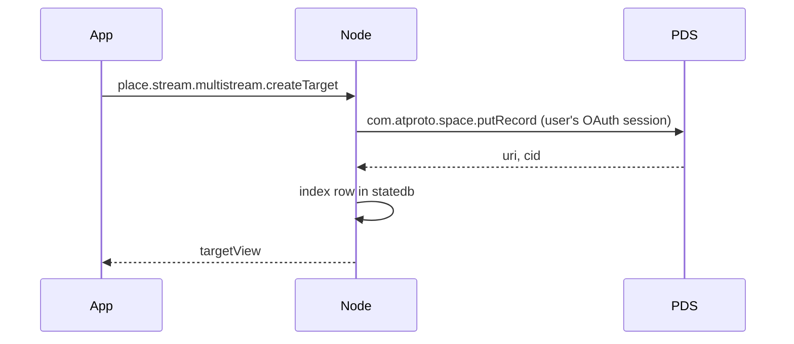

# atproto spaces

Streamplace keeps each user's private records in an
[atproto space](https://github.com/bluesky-social/proposals/tree/main/0016-permissioned-data)
on the user's own PDS: data that must never reach the firehose, such as a
multistream target's RTMP URL with its stream key. Until now that data lived
only in the node's stateful database, under record URIs that were never real.

Spaces are an alpha that ships breaking changes weekly. This document
describes the wire Streamplace targets, pinned in [Testing](#testing).

## The personal space

Every user has at most one Streamplace space, with the user's own DID as its
authority:

```
at://{did}/space/place.stream.personal/self
```

| Part       | Value                              | Notes                                               |
| ---------- | ---------------------------------- | --------------------------------------------------- |
| space type | `place.stream.personal`            | one type for all private Streamplace data           |
| space key  | `self`                             | one space per user                                  |
| policy     | `com.atproto.personalspace.policy` | only the owner can read; there are no other writers |

A record in it is addressed as
`at://{did}/space/place.stream.personal/self/{did}/{collection}/{rkey}`.
`pkg/spaces` builds the personal space URI and holds the few
`com.atproto.space.*` calls the node makes (`createSpace`, `putRecord`,
`deleteRecord`).

Collections in the space today:

| Collection                        | Was                                 |
| --------------------------------- | ----------------------------------- |
| `place.stream.multistream.target` | statedb table `multistream_targets` |

The other private data in statedb moves the same way, one collection at a
time; see [Adding a collection](#adding-a-collection).

## Authorization

A PDS only lets the node touch a space through an OAuth grant; vlpds refuses
password and app-password sessions outright. The grant is a permission
inside the `place.stream.authFull` permission set the app already requests:

```json
{
  "type": "permission",
  "resource": "space",
  "spaceType": "place.stream.personal",
  "authority": "self",
  "collection": ["place.stream.multistream.target"],
  "action": ["read", "create", "update", "delete"],
  "manage": ["create"]
}
```

It lives in the permission set, not in the scope string, on purpose:

- The scope string (`include:place.stream.authFull`) does not change, so
  nobody has to log in again. A PDS re-expands the permission set when it
  refreshes a token, and the node stores the granted scope from every
  refresh, so existing sessions pick the grant up on their own.
- A PDS without spaces ignores a permission whose resource it does not know
  and logs the user in as before. An explicit `space:` scope would instead be
  dropped at login for good, and need a fresh login once that PDS gains
  spaces.

A PDS with spaces also resolves the space type declaration,
`place.stream.personal`, to show its `name` on the consent screen. Login
fails with `invalid_scope` if it cannot, so the declaration is published
with the permission set.

### Where the two lexicon documents live

The declaration (`"type": "space"`) and the permission (`"resource":
"space"`) are not valid to indigo's lexicon parser, which glex and the
node's own lexicon loading run over every file under `lexicons/`. Both
documents therefore live in `pkg/spaces/lexicons/` as raw JSON:

- `place.stream.personal.json`, written by hand.
- `place.stream.authFull.json`, generated by `make lexicons`: the ordinary
  `lexicons/place/stream/authFull.json` plus the space permission, whose
  collections are copied from the declaration.

Whoever publishes lexicons to the `place.stream` authority account (the
release script, and the e2e harness for its local authority) publishes these
in place of the same-named documents from `lexicons/`. When indigo and glex
can parse spaces, move both files into `lexicons/` and delete the overlay.

## How the node uses the space

The space is the source of truth. The statedb table stays, as the node's
index of it: a live stream's multistream loop reads its targets every few
seconds with no user request in flight, and every node of a station has to
see the same answer.



- **Writes** go to the PDS first, then to the index. The node acts through
  the user's stored OAuth session, the one it already uses to write public
  records.
- **Reads** come from the index.
- **Row URIs never change.** The index and every API view use
  `at://{did}/place.stream.multistream.target/{rkey}`. The `in_space` column
  marks rows backed by the space, under the same collection and record key.

### Moving a user over

Nothing is migrated in bulk. Whenever a user with old rows calls a
multistream endpoint and the node holds a usable session for them, it writes
each row with `in_space = false` into the space under the same record key,
then sets `in_space = true` and stores the returned CID. Row URIs and event
references stay untouched. Moving is safe to repeat and never fails the
request: the first error stops the move, and remaining rows are tried again
next time.

A user stays on the old path, with nothing changed for them, when their PDS
has no spaces, when their session predates the grant and has not refreshed
yet, or when the node has no session for them. A new target created while
the PDS is unreachable is saved the old way and moves later. Updating or
deleting a target that is already in the space fails if the PDS write fails,
because the index must not disagree with the space. For the same reason each
handler holds a per-user lock from the move through its own PDS and index
writes, so two requests cannot apply them in different orders.

## Adding a collection

1. Make sure the data is an atproto record with a lexicon under `lexicons/`.
2. Add the collection to `collections` in
   `pkg/spaces/lexicons/place.stream.personal.json` and run `make lexicons`.
   Existing sessions gain write access to it on their next token refresh.
3. Write through `pkg/spaces` and index in statedb, as the multistream
   handlers in `pkg/spxrpc/place_stream_multistream.go` do. Keep row URIs
   stable and track space backing separately, including for existing rows.
4. Extend the e2e flows below.

Candidates, in rough order of readiness:

| Data                   | Today                                     | Needs                                                          |
| ---------------------- | ----------------------------------------- | -------------------------------------------------------------- |
| Draft videos           | `draft_videos`, already shaped as records | its `ats://` URIs and separate space type folded into this one |
| S3 storage credentials | `storage`, a plain SQL row                | a record lexicon; nothing reads the stored URL yet             |
| Webhooks               | `webhooks`, plain SQL columns             | a record lexicon                                               |

## Testing

`DEV_ENV_PDS` selects the PDS the e2e harness starts:

| `DEV_ENV_PDS` | PDS                                                             | Covers                                 |
| ------------- | --------------------------------------------------------------- | -------------------------------------- |
| unset         | reference PDS, stable release                                   | a PDS without spaces: the old path     |
| `spaces`      | reference PDS, `@atproto/pds@0.0.0-spaces-alpha-20261105160032` | the alpha as Bluesky ships it          |
| `vlpds`       | [vlpds](https://github.com/jazware/vlpds), image `sha-dba483f`  | the PDS Streamplace runs in production |

```sh
hack/fetch-spaces-pds.sh   # once: installs the alpha PDS beside the workspace
hack/fetch-vlpds.sh        # once, on a machine with Docker
hack/e2e-web-local.sh flows/private-space.spec.ts
DEV_ENV_PDS=spaces hack/e2e-web-local.sh flows/private-space.spec.ts
DEV_ENV_PDS=vlpds hack/e2e-web-local.sh flows/private-space.spec.ts
```

In HTTPS mode the harness seeds one multistream target for the test account
before anything logs in, so it lands on the old path. The flows then log in through
the PDS's real consent screen and check, by reading the space from the PDS
with its admin credentials, that the seeded target moved into the space and
that creating, renaming and deleting a target in the app does the same on
the PDS. `js/e2e-web/flows/private-space.spec.ts` covers the web app and
`.maestro/logged-in/private-space.yaml` the mobile apps.

Both spaces PDSes must agree on the wire. vlpds releases up to 1.3.0, and
the `bluesky-social/vlpds` fork, implement an older, incompatible alpha
(`simplespace`); only vlpds builds from 7 November 2026 on speak this one.
To move to a newer alpha, change the version in
`js/dev-env/spaces-pds/package.json`, the image in `hack/fetch-vlpds.sh`,
and the table above together.

Neither spaces PDS is installed by the root workspace. The alpha PDS lives in
`js/dev-env/spaces-pds/`, a workspace of its own with its own lockfile, so
its prerelease dependency tree cannot disturb the app's.

The local PLC serves modern `Multikey` DID documents for every flavor, keeping
the same public keys and signed operation logs. Its legacy library otherwise
serves raw 2019 ECDSA keys, which the pinned vlpds cannot use to verify the
lexicon publisher's CAR proofs.

## Limits

- The node does not read the space back. A record another app writes into
  the space does not reach the index.
- The index still holds a copy of every private record, in statedb.
- API record URIs identify index rows, not the records' space addresses.
- The Maestro flow runs on Android. Nothing in the repository runs
  backend-backed flows on iOS yet.
