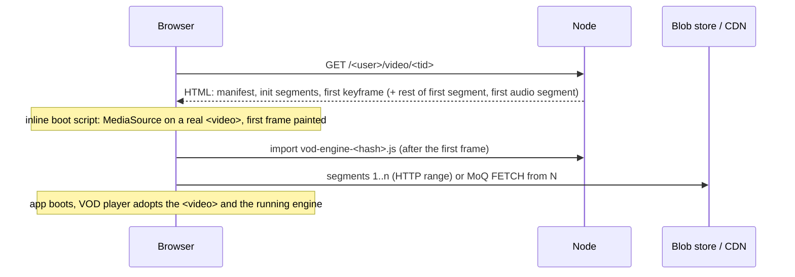

# VOD instant start

A video page (`/<user>/video/<tid>`) paints its first frame from its own HTML,
before the app bundle loads, then keeps playing on a small engine that the app
adopts once it boots. Segments after the first come over Media over QUIC or HTTP
byte ranges, whichever the node offers first and the browser can use.



## Manifest

`place.stream.playback.getVideoManifest?uri=<at-uri>[&start=ms][&end=ms][&sid=]`
returns JSON (`application/json`), gated like `getVideoPlaylist` (labels, bans,
playback session, clip bounds), including bans on the resolved blob's track owners.
The page embeds the same object.

```jsonc
{
  "uri": "at://did:plc:…/place.stream.video/<rkey>",
  "sid": "<playback session id>",
  "durationMs": 30000, // clip-local; lexicons have no float type
  "tracks": [
    {
      "id": "1", // MUXL track id
      "type": "video", // "video" | "audio"
      "codec": "avc1.64001f", // RFC 6381, for MediaSource.isTypeSupported
      "width": 1280,
      "height": 720, // video only
      "channels": 2,
      "sampleRate": 48000, // audio only
      "bandwidth": 2500000, // bits/s, as in the HLS master playlist
      "timescale": 90000,
      "init": "<base64 init segment>",
      "url": "<blob URL: CDN (signed) or getVideoBlob, carrying did and sid>",
      "first": 0, // metafile index of segments[0] (clips start later)
      "offsets": [0],
      "sizes": [0],
      "durations": [0], // per segment; offsets absolute in the blob, durations in timescale ticks
    },
  ],
  "sources": [
    // preference order; the engine uses the first one it can, HTTP always last
    {
      "type": "moq",
      "url": "https://host:port",
      "fingerprint": "<sha-256 hex, self-signed only>",
      "broadcast": "vod/<did>/<rkey>/<sid>",
    },
    { "type": "http" },
  ],
}
```

- Video tracks: every video track, lowest bandwidth first. Audio tracks: the full
  mix only (lowest `group`), default (AAC preferred) first, same choice as the
  HLS master playlist.
- A segment's start time is the sum of the `durations` before it, over the
  clip-local timeline. Fragments keep their own `tfdt`; the engine sets
  `SourceBuffer.timestampOffset` from the parsed `tfdt` so discontinuities and
  clip starts land where the manifest says.

## Sources

**HTTP:** segment `i` of a track is `Range: bytes=offsets[i]-(offsets[i]+sizes[i]-1)` of
`track.url`, exactly the byte range the HLS media playlist names.

**MoQ** (`--vod-moq`, on by default when the MoQ listener runs; offered before
HTTP unless `--vod-cdn-url` is set): broadcast `vod/<did>/<rkey>/<sid>` on the
node's listener. Track name = the manifest track `id`. Group sequence = the
metafile segment index (`first + i`). Each group carries one frame: the segment
bytes, identical to the HTTP range. Groups are served on demand
(`TrackProducer.Dynamic`), read from the blob store, and logged to the view log
as segment requests for `sid`. The `sid` is verified like the HTTP path's;
a labelled video, banned video owner, or banned content track owner is refused (404).

## The page

`GenerateVideoCard` inserts, at the start of `<body>` (outside `#root`, which
React replaces):

```html
<div id="sp-vod-boot"><video playsinline></video></div>
<script id="sp-vod-manifest" type="application/json">
  …manifest…
</script>
<script id="sp-vod-starter" type="application/json">
  {
    "video": { "track": "1", "key": "<b64>", "rest": "<b64>|null" },
    "audio": { "track": "2", "data": "<b64>|null" }
  }
</script>
<script>
  /* vod-boot.js, inlined */
</script>
```

- **Starter:** segment 0 of the first (lowest) video track, split into a
  keyframe-only fragment (`key`) and the remainder (`rest`, `tfdt` advanced),
  plus segment 0 of the first audio track. Inlined greedily as key, audio, rest
  within 512 KiB of raw media; `audio` is omitted for a video without audio.
  Anything over the budget is `null`. Without the keyframe or required audio data,
  boot gives way to a fresh app engine. A missing `rest` still paints the keyframe;
  the engine fetches the whole segment and MediaSource replaces the overlap.
  A gated video's page gets no boot payload at all.
- No starter (only the manifest and boot script) when the page has a `?t=`, the
  video is a clip that does not start at segment 0's start, or the video is gated.
- `vod-boot.js` opens a `MediaSource` on the `<video>`, appends the inits and the
  starter, attempts `play()` (a blocked autoplay leaves the first frame showing),
  and, from the first frame's `requestVideoFrameCallback`, imports
  `vod-engine-<hash>.js` (its URL in `data-engine` on `#sp-vod-boot`), which
  continues playback and stores itself at `window.__spVod`.
- Both scripts are built by `js/app/scripts/bundle-vod.mjs` (esbuild, run by
  `pnpm run export`) into `dist/_expo/static/js/web/`, so they share the app's
  immutable caching. `dist/_expo/static/js/web/vod-boot.json` names them for the
  node: `{"boot": "<inline script source>", "engine": "/_expo/static/js/web/vod-engine-<hash>.js"}`.
- The node caches each video's starter (metafile, inits, starter bytes) in
  memory; the `sid` and signed URLs are minted per request.

## The app

The web VOD player (`js/components`, `mode === "vod"`, a `place.stream.video`
source) uses the same engine:

- `window.__spVod` holds an engine for this URI: adopt it, moving its `<video>`
  into the player and removing `#sp-vod-boot`.
- Otherwise, with `MediaSource` or `ManagedMediaSource`: fetch the manifest and
  start a fresh engine.
- Otherwise, or on an engine error before playback: the existing `HLSPlayer`.

The engine starts on the lowest video track and switches up at segment
boundaries when measured throughput allows (or pins the quality menu's choice),
buffers ~30 s ahead, evicts behind, handles seeking and `startTime`, and ends the
stream after the last segment.
